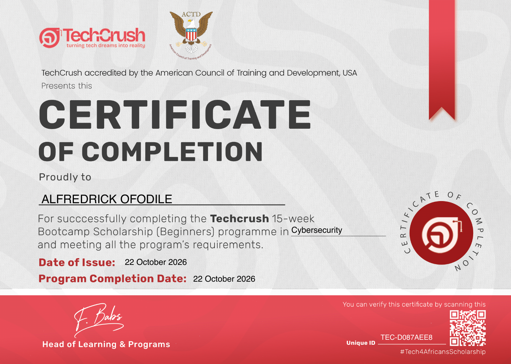

# Alfredrick Ofodile

**Cybersecurity Analyst · Web3 Security (2 years) · AI Engineer**

I work across cybersecurity, Web3 security research, and AI engineering. My public work includes security disclosures, audit findings, a reproducible SOC lab, and software projects.

**Certification:** Cybersecurity — 22 October 2026.

## Socials

- [HackenProof](https://hackenproof.com/hackers/YeandAmen)
- [GitHub](https://github.com/YeandAmen)
- [X](https://x.com/yeandamen)

---

---

## Selected Disclosures

Public writeups and corresponding fixes. The date column shows the month the fix was merged.

| Date | Project | Vulnerability | Status | References |
|------|---------|---------------|--------|------------|
| 2026-09 | MultiversX | Unbounded Kad-DHT `/pk/` record storage: a connected peer could submit valid public-key records for unrelated identities, causing sustained memory growth and potential denial of service. | Fixed in the verified v1.4.1 communication library, included in node v2.1.7 | [Report](https://gist.github.com/YeandAmen/fd4431b5b22222dcb3f266dd7464f5a8) · [Fix](https://github.com/multiversx/mx-chain-communication-go/commit/6820c97770587a13f288bb3591028a95101e4b8e) · [Merged PR](https://github.com/multiversx/mx-chain-communication-go/pull/76) |

**MultiversX timeline (UTC):** Report gist created **12 August 2026 at 16:17:47**; fix commit dated **14 August 2026 at 13:08:45**; associated PR merged into `main` **7 September 2026 at 07:44:22**. The fix disables value-record operations in both affected DHT discoverers.

### Acknowledged Disclosures

| Project | Status | References |
|---------|--------|------------|
| Osmosis | Report acknowledged; fix private | [Report: unrecovered panic in MEV bundle processing](https://gist.github.com/YeandAmen/0cbd7a9df6d573c0080854f53cbb3caf) |

---

## Audit Portfolio

### Overall Findings Summary

| Overall | Critical Risk | High Risk | Medium Risk | Low Risk | Info | Unclassified |
|---------|---------------|-----------|-------------|----------|------|--------------|
| **47 Findings** | 6 | 15 | 12 | 11 | 2 | 1 |

### Contests

| Contest Name                 | Critical | High | Medium | Low | Visibility     | Platform    |
|-----------------------------|----------|------|--------|-----|----------------|-------------|
| BELONG Smart Contract Audit | 1        | -    | 1      | -   | Public Contest | Immunefi    |
| Blackhole                   | -        | -    | -      | 1   | Public Contest | Code4rena   |
| Blockz Smart Contract Audit | -        | -    | -      | 3   | Public Contest | HackenProof |
| Index Fun Order Book        | -        | -    | 1      | -   | Public Contest | Sherlock    |
| DCA Smart Contract Audit    | -        | 1    | 1      | -   | Public Contest | Sherlock    |
| Alignerz 4                  | -        | 3    | 1      | -   | Public Contest | Dualguard   |

**Total Contest Findings: 10 (plus 1 Critical) — HackenProof excluded**

### First-Flight Audits

| Project Name     | High | Medium | Low | Platform     |
|-----------------|------|--------|-----|--------------|
| Weather_Witness | 3    | -      | -   | First-Flight |

**Total First-Flight Findings: 3**

### Private Audits

| Project Name  | Critical | High | Medium | Low | Info | Visibility   |
|---------------|----------|------|--------|-----|------|--------------|
| ODDSHOT V1    | -        | 2    | 2      | 2   | 2    | Public Audit |
| PowerProtocol | 2        | 2    | 4      | 2   | -    | Public Audit |

**Total Private Audit Findings: 18**

### Vulnerability Disclosure

| Platform     | Findings | Visibility |
|-------------|----------|------------|
| HackenProof | 11       | Hidden     |

Profile: https://hackenproof.com/hackers/YeandAmen

---

## Notes

- All findings listed are verifiable and responsibly disclosed.
- Severity classifications follow audit and disclosure standards.
- Private audit details are summarized to respect confidentiality.

---

### Cybersecurity Certificate

