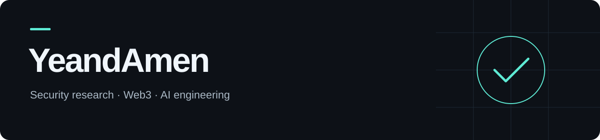

I'm **YeandAmen**. I research security across AI systems and Web3, build useful software, and share what I learn.

[HackenProof](https://hackenproof.com/hackers/YeandAmen) · [X](https://x.com/yeandamen) · [Telegram](https://t.me/yeandamen) · [GitHub](https://github.com/YeandAmen)

## Selected disclosures

| Project | Finding | Status | Read more |
| :--- | :--- | :--- | :--- |
| **Grok / xAI** | Python startup-hook persistence after execution of an uploaded archive | Fixed — researcher-reported | [Write-up](disclosures/grok-python-startup-persistence/README.md) |
| **MultiversX** | Unbounded Kad-DHT public-key record storage and memory growth | Fixed in communication library v1.4.1; included in node v2.1.7 | [Report](https://gist.github.com/YeandAmen/fd4431b5b22222dcb3f266dd7464f5a8) · [Fix](https://github.com/multiversx/mx-chain-communication-go/commit/6820c97770587a13f288bb3591028a95101e4b8e) · [PR](https://github.com/multiversx/mx-chain-communication-go/pull/76) |
| **Osmosis** | Unrecovered panic in MEV bundle processing | Acknowledged; fix private | [Report](https://gist.github.com/YeandAmen/0cbd7a9df6d573c0080854f53cbb3caf) |

### Grok · recorded demonstration

https://github.com/user-attachments/assets/50032307-699f-472e-ad1b-dfbbdacb85d8

MultiversX disclosure timeline

All times UTC. Report gist created **12 August 2026 at 16:17:47**; fix commit dated **14 August 2026 at 13:08:45**; associated PR merged into `main` **7 September 2026 at 07:44:22**. The fix disables value-record operations in both affected DHT discoverers.

## Findings portfolio

| Total | Critical | High | Medium | Low | Info | Unclassified |
| :--- | :--- | :--- | :--- | :--- | :--- | :--- |
| **47** | 6 | 15 | 12 | 11 | 2 | 1 |

Explore contests, audits, and disclosures

### Contests

| Contest Name                 | Critical | High | Medium | Low | Visibility     | Platform    |
|-----------------------------|----------|------|--------|-----|----------------|-------------|
| BELONG Smart Contract Audit | 1        | -    | 1      | -   | Public Contest | Immunefi    |
| Blackhole                   | -        | -    | -      | 1   | Public Contest | Code4rena   |
| Blockz Smart Contract Audit | -        | -    | -      | 3   | Public Contest | HackenProof |
| Index Fun Order Book        | -        | -    | 1      | -   | Public Contest | Sherlock    |
| DCA Smart Contract Audit    | -        | 1    | 1      | -   | Public Contest | Sherlock    |
| Alignerz 4                  | -        | 3    | 1      | -   | Public Contest | Dualguard   |

**Total Contest Findings: 10 (plus 1 Critical) — HackenProof excluded**

### First-Flight Audits

| Project Name     | High | Medium | Low | Platform     |
|-----------------|------|--------|-----|--------------|
| Weather_Witness | 3    | -      | -   | First-Flight |

**Total First-Flight Findings: 3**

### Private Audits

| Project Name  | Critical | High | Medium | Low | Info | Visibility   |
|---------------|----------|------|--------|-----|------|--------------|
| ODDSHOT V1    | -        | 2    | 2      | 2   | 2    | Public Audit |
| PowerProtocol | 2        | 2    | 4      | 2   | -    | Public Audit |

**Total Private Audit Findings: 18**

### Vulnerability Disclosure

| Platform     | Findings | Visibility |
|-------------|----------|------------|
| HackenProof | 11       | Hidden     |

Profile: https://hackenproof.com/hackers/YeandAmen

Private audit details are summarized to respect confidentiality.

## Things I build

I build tools for problems I run into: repetitive YouTube work, scattered opportunities, trips across Abuja, and making security easier to understand.

| Project | Why I built it |
| :--- | :--- |
| [Tinker](https://tinker-video.vercel.app) | Easier YouTube video automation. I got tired of copying prompts, generating images, keeping characters consistent, and assembling everything manually—so I built a studio and Chrome extension to handle the repetitive work, from script and scenes to a finished video. |
| [Underdog](https://github.com/YeandAmen/underdog) · [Demo](https://underdog-fyield1.vercel.app) | Helps office teams understand who has access, spot suspicious activity, and investigate threats. Accounts, access checks, alerts, evidence, and AI reports come together in one workspace. |
| [Sinnogram](https://github.com/YeandAmen/sinnogram) · [Try it](https://sinnogram.vercel.app) | Plans a better order for stops around Abuja, so errands mean less backtracking. Compare driving routes, keep an itinerary, and open each leg in your maps app. |
| [Radwave](https://github.com/YeandAmen/radwave) · [Try it](https://radwave.vercel.app) | Brings jobs, scholarships, grants, fellowships, and other opportunities into one searchable workspace, with a globe explorer, shortlists, deadlines, and sources from LinkedIn, RSS, publishers, and X. |
| [SOC Playground](https://github.com/YeandAmen/SOC-Playground) | A reproducible Splunk security lab for practising attack detection with Windows and Kali telemetry, simulations, and a live trace console. |
| [X Opportunity Scraper](https://github.com/YeandAmen/X) | My original Go service for finding opportunities on Twitter/X, with an API and email digests. Its ingestion workflow is now part of Radwave. |
| [Audit Findings](https://github.com/YeandAmen/Audit-Findings-) | Shared smart contract security research documenting vulnerabilities found through group analysis of protocols and DeFi systems. |

[Explore my repositories →](https://github.com/YeandAmen?tab=repositories)
